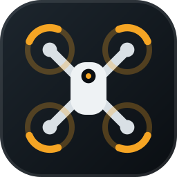
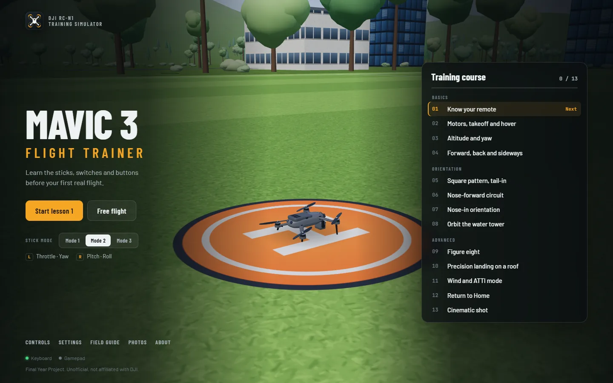
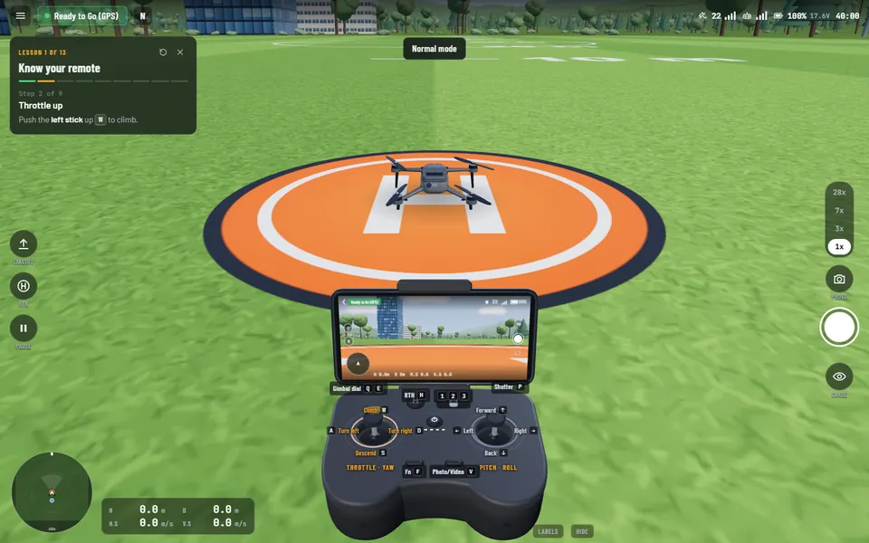
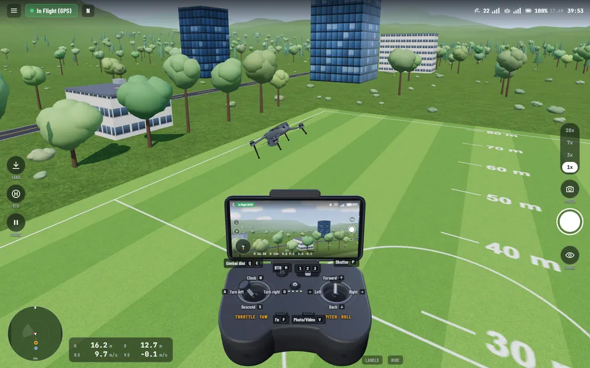
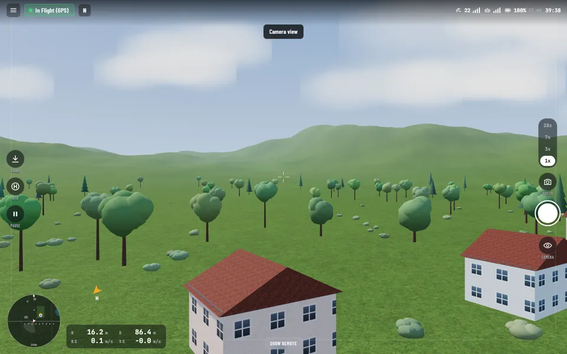

<p align="center">
  
</p>

<h1 align="center">Mavic 3 Flight Trainer</h1>

<p align="center">
  Learn the DJI Mavic 3 and its RC-N1 remote before your first real flight.<br>
  A free 3D drone simulator that runs in your browser.
</p>

<p align="center">
  <a href="https://razee4315.github.io/mavic3-flight-trainer/app/"><b>Launch the simulator</b></a> ·
  <a href="https://razee4315.github.io/mavic3-flight-trainer/">Website</a> ·
  <a href="https://razee4315.github.io/mavic3-flight-trainer/lessons/">Lessons</a>
</p>



| Guided lessons | In flight | Camera view |
|---|---|---|
|  |  |  |

## Features

- **Real flight modes.** Cine 5 m/s, Normal 15 m/s, Sport 21 m/s, with the matching climb rates.
- **GPS hold and braking.** Let go and it hovers. Without GPS it drifts in ATTI mode.
- **Combination Stick Command.** Start and stop the motors like the real aircraft.
- **Obstacle sensing.** Braking in Normal and Cine, off in Sport. Power lines can't be seen.
- **Return to Home.** Manual and smart low-battery RTH, plus a forced landing at critical battery.
- **Gimbal and camera.** −90° to +35° tilt, 1x to 28x zoom, photos and video.
- **A 3D RC-N1 remote** whose sticks, switches and buttons move as you fly.
- **Stick modes 1, 2 and 3**, and three views: chase, camera and pilot.

## Lessons

| Basics | Orientation | Advanced |
|---|---|---|
| 1. Know your remote | 5. Square pattern, tail-in | 9. Figure eight |
| 2. Motors, takeoff and hover | 6. Nose-forward circuit | 10. Precision landing on a roof |
| 3. Altitude and yaw | 7. Nose-in orientation | 11. Wind and ATTI mode |
| 4. Forward, back and sideways | 8. Orbit the water tower | 12. Return to Home |
| | | 13. Cinematic shot |

## Controls

| Real remote | Keyboard | Gamepad |
|---|---|---|
| Left stick | W A S D | Left stick |
| Right stick | Arrow keys | Right stick |
| Start / stop motors | S+D with ↓+← | Both sticks down and in |
| Flight mode C / N / S | 1 / 2 / 3 | D-pad |
| Pause (tap) / RTH (hold) | Space / H | B |
| Auto takeoff / land | Hold T | Start |
| Gimbal dial | Q / E | LT / RT |
| Shutter | P | A |
| Change view | C | Y |
| Menu | Esc | Back |

Hold Shift for gentle input. Touch screens get on-screen sticks.

## Run locally

Open `Mavic 3 Flight Trainer.html` in Chrome, Edge or Firefox. The first load needs internet for Three.js and the fonts.

## Develop

| Path | What it is |
|---|---|
| `src/app.html` | The simulator source |
| `site/pages.py` | The website pages, sitemap and robots.txt |
| `docs/` | Everything GitHub Pages serves (generated, plus `assets/`) |

After editing, rebuild:

```bash
python build.py
```

## About

Built as our **Final Year Project**. We needed to learn the basic controls of a drone, so we made a safe place to practise before flying the real aircraft.

Unofficial training tool. Not affiliated with or endorsed by DJI.
